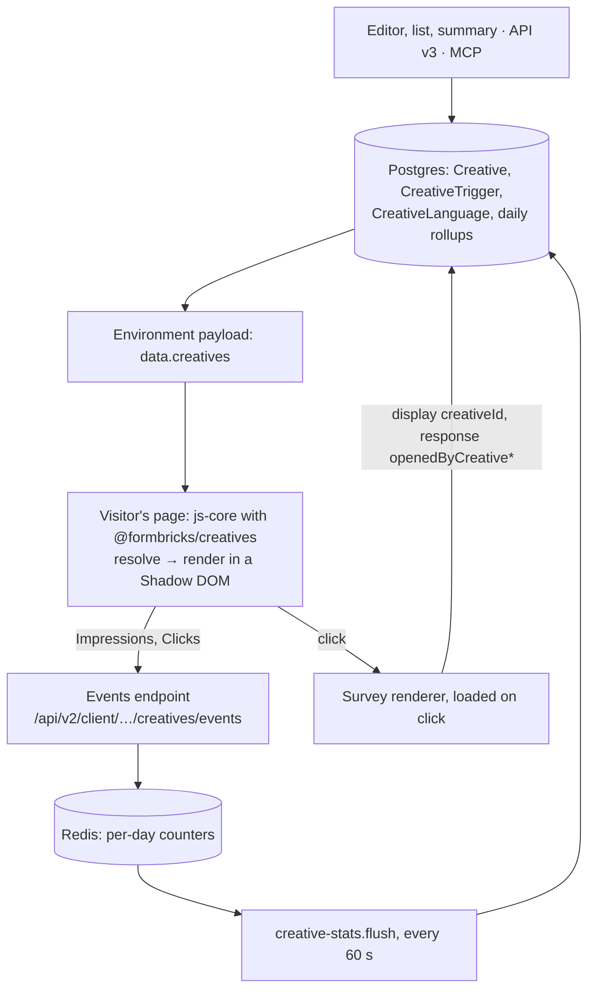

## Context

<Note>
  Creatives are part of the Formbricks [Enterprise Edition](/self-hosting/advanced/license), on self-hosted
  instances whose license includes Creatives. They are not available on Formbricks Cloud.
</Note>

A creative is a feedback button or a banner that the web SDK draws on the customer's site and that opens a survey or a link when pressed. The customer-facing behavior lives in [Creatives](/surveys/creatives/overview); this page is for engineers who meet the code later. Each decision below has a short ADR in [`docs/adr/`](https://github.com/formbricks/formbricks/tree/main/docs/adr) (0003–0014); this page connects them.

A creative has three parts:

- **What it shows:** type-specific `content` and `styling` (JSON, validated per type).
- **When it shows:** `showOn` (page view or actions, through `CreativeTrigger`), `showConditions`, `displayPercentage`, `startAt` and `endAt`.
- **Its Destination:** a survey (`surveyId`) or a link (`linkUrl`). A banner without a button has neither.

## How The Pieces Connect

| Piece | Where |
| --- | --- |
| Data model: `Creative`, `CreativeTrigger`, `CreativeLanguage`, `CreativeDailyStat`, `CreativeDailyPageStat`; `Display.creativeId` | `packages/database/schema/creatives.prisma`, `main.prisma` |
| Admin UI, services, write rules, derived status, authorization, license access | `apps/web/modules/ee/creatives` |
| API v3 routes and the spec under the adopted `V3 Creatives` tag | `apps/web/app/api/v3/creatives`, `docs/api-v3-reference/src/paths/api_v3_creatives*.yml` |
| MCP tools, thin adapters over the v3 operations | `apps/web/modules/mcp/tools/creatives.ts` |
| Delivery to the SDK and server-resolved styles | `modules/ee/creatives/lib/delivery.ts`, `lib/style.ts`, `app/api/v1/client/[workspaceId]/environment/lib/data.ts` |
| Renderer, consumed from source: `resolve`, `render`, click and event rules | `packages/creatives/src` |
| SDK wiring: reconcile, layout, event batching | `packages/js-core/src/lib/creatives` |
| Counting: events endpoint, Redis counters, flush job | `app/api/v2/client/[workspaceId]/creatives/events/route.ts`, `modules/ee/creatives/lib/client-events.ts`, `counters.ts`, `stats-flush.ts` |
| Attribution on displays and responses | `modules/ee/creatives/lib/attribution.ts`, `packages/surveys` (display creation) |

## Why Creatives Render In js-core, Inside A Shadow DOM

ADR [0005](https://github.com/formbricks/formbricks/blob/main/docs/adr/0005-render-in-the-sdk-shadow-dom.md).

**Context.** A feedback button renders on every matching page view, on the order of a billion a year for one large customer. js-core is loaded on every page; the survey bundle (about 240 KB gzipped) loads only when a survey shows.

**Decision.**

- A tiny DOM renderer, `@formbricks/creatives`, is bundled into js-core. `packages/js-core/src/bundle-size.test.ts` holds it to 6,250 B gzipped and js-core to 21,000 B.
- `resolve` decides from the cached environment state and the page context what to show; `render` draws it. Neither touches the network.
- Each creative sits in an open Shadow DOM whose `:host` starts from `all: initial`, with px units. Host-page CSS can't reach in; with **Page font** on, `font-family` inherits through it.
- Styles arrive as server-resolved values per appearance (light, dark) and device (desktop, phone), so the renderer holds no theme logic. They go into a `<style>` element in the shadow root carrying the nonce from `setNonce()`, so strict CSPs work; insets use `style.setProperty`, which a CSP without `'unsafe-inline'` allows.
- Only the creative's own compiled Custom CSS enters the shadow root; workspace CSS never does (ADR [0014](https://github.com/formbricks/formbricks/blob/main/docs/adr/0014-own-css-only.md)).
- The survey bundle loads only on a click. js-core requests it from a versioned URL (`/js/surveys.umd.cjs?v=<content hash>`), so a new SDK never runs an old cached renderer that would drop attribution.
- The editor preview mounts the same `render`.

**Rejected.** Rendering in the survey bundle (240 KB on every page view); the light DOM under `#fbjs` (host CSS and survey-oriented workspace CSS leak both ways); a separate React preview (it drifts from what visitors see).

**The SDK loop.** `reconcileCreatives` (`packages/js-core/src/lib/creatives/creatives.ts`) runs on every page view (single-page-app route changes included), on every tracked action, on a state refresh, when the nonce, appearance or language changes, after a banner dismiss and at the next schedule boundary. At SDK start it draws the creatives in the cached state before the refresh, so an In page banner appears with the page; a failed refresh takes them off again. `layout.ts` stacks banners per edge and passes the space Overlay banners take to feedback buttons as CSS custom properties.

**The click path** (ADR [0006](https://github.com/formbricks/formbricks/blob/main/docs/adr/0006-the-click-wins.md)) doesn't go through `triggerSurvey`: `openSurveyForCreative` renders the Destination survey right away with no delay or auto-close, bypassing its triggers, conditions, segment, recontact, cooldown and percentage. The display it creates still updates the user's displays and `lastDisplayAt`. Pressing while the same survey is open does nothing; a different open survey is closed first.

## Why Impressions And Clicks Are Counters, Not Events

ADR [0007](https://github.com/formbricks/formbricks/blob/main/docs/adr/0007-counters-not-event-rows.md).

**Context.** An always-on button produces on the order of a billion impressions a year for one customer.

**Decision.**

- The SDK batches a page view's events into requests of at most 100 events, sent 2 s after the first event, on `pagehide`, or as soon as 100 are queued; a page view with more events sends more than one. It goes as `text/plain` with `keepalive`, so there is no CORS preflight. An Impression is once per creative per page view (host + path); a Click is a press that opened the Destination.
- The events endpoint always answers 204. It drops bots, bodies over 16 KB, ids that aren't countable creatives of the workspace (cached for 60 s) and requests over the IP rate limit (`rateLimitConfigs.api.clientCreativeEvents`, 600 a minute).
- One Lua script increments Redis hashes per creative and UTC day: by device type, and by page, capped at 1,000 pages a creative a day with the rest under `(other)`. Keys live about 48 h.
- The `creative-stats.flush` job runs every 60 s and upserts yesterday's and today's totals into `CreativeDailyStat` and `CreativeDailyPageStat` with `GREATEST(stored, counted)`. A run takes at most 50 claims of 100 creatives per day; a larger backlog waits for the next run, so counts can then lag more than a minute.

**Rejected.** A row per event (about a billion rows a year); a synchronous increment per request (hot-row contention at peaks); client-side sampling (product wants exact counts).

**Consequences.**

- Only aggregates can be reported, and a new breakdown can't be backfilled. That is why device type is on the daily totals from day one.
- The flush is idempotent, so overlapping replicas and a repeated run are harmless.
- Without a BullMQ worker the counters never reach Postgres and expire from Redis after about 48 h. If Redis is unavailable or refuses writes, the endpoint still answers 204 and the counts are lost.

## Why A Creative's Status Is Derived

ADR [0004](https://github.com/formbricks/formbricks/blob/main/docs/adr/0004-store-intent-derive-status.md).

**Context.** A creative stores its author's intent: `status` (`draft · inProgress · paused · completed`, the survey values), `archivedAt` and `publishedAt`. A survey's status is written from 8+ paths: the editor, the list, the summary, API v1 and v3, MCP, the close-date job, the response-limit auto-complete and archiving.

**Decision.** What everyone sees is computed by one function, `getCreativeDisplayState` (`modules/ee/creatives/lib/display-status.ts`), in this order:

1. **Archived** if `archivedAt` is set; **Draft** and **Closed** (`completed`) as the author set them.
2. **Closed** (`scheduleEnded`) once `endAt` has passed.
3. **Paused** as the author set it.
4. **Paused** (`destinationMissing`, `actionMissing`) when delivery could never show it. The same rule, `getCreativeDeliveryGap`, keeps it out of the SDK payload.
5. **Scheduled** before `startAt`.
6. **Paused** (`surveyNotActive`) while the Destination survey isn't `inProgress` or is archived. Link Destinations and banners without a button only follow their own status and schedule.
7. Otherwise **Active**.

`display-status-sql.ts` is its SQL twin for list filters, and `display-status-cases.ts` holds both to one case table. The API exposes the writable `status` and a read-only `displayStatus` with `displayStatusReason`.

**Why.** Writing a survey's state onto its creatives would miss some of those paths, and the two would disagree. Deriving it also removes the need for a minute-level cron for schedules.

**Consequences.**

- Resuming a survey brings its creatives back by themselves. The resume dialog's **Keep these creatives paused** is the only place a survey change writes to creatives.
- A new reason a creative can't show only adds a row to the derivation and its SQL twin.
- A save that would turn a creative that isn't Active into Active stores `paused` instead, so editing never takes a creative live.

## Other Decisions

| Decision | ADR |
| --- | --- |
| One `Creative` table for every type, with per-type `content` and `styling` JSON | [0003](https://github.com/formbricks/formbricks/blob/main/docs/adr/0003-one-creative-table.md) |
| A click opens the Destination whatever the survey's own targeting says | [0006](https://github.com/formbricks/formbricks/blob/main/docs/adr/0006-the-click-wins.md) |
| `Display.creativeId` without a foreign key; `openedByCreativeId` and `openedByCreativeName` on responses, stamped by the server | [0008](https://github.com/formbricks/formbricks/blob/main/docs/adr/0008-attribution-on-displays-and-responses.md) |
| One show-conditions schema and evaluator in `@formbricks/types` for surveys and creatives | [0009](https://github.com/formbricks/formbricks/blob/main/docs/adr/0009-shared-show-conditions.md) |
| Workspace-level authorization (`read` views, `readWrite` edits), no SpiceDB definition; the license gate runs on top | [0010](https://github.com/formbricks/formbricks/blob/main/docs/adr/0010-workspace-level-authorization.md) |
| MCP tools reuse `surveys:read` and `surveys:write` | [0011](https://github.com/formbricks/formbricks/blob/main/docs/adr/0011-reuse-survey-scopes-for-mcp.md) |
| The Destination is a composite FK `[surveyId, workspaceId]` with `onDelete: NoAction`; the app answers 409 first | [0012](https://github.com/formbricks/formbricks/blob/main/docs/adr/0012-destination-fk-no-action.md) |
| A missing translation falls back to the default language, unless the popup survey would be skipped | [0013](https://github.com/formbricks/formbricks/blob/main/docs/adr/0013-default-language-fallback.md) |
| Only the creative's own CSS, scoped to `.fb-creative-button` or `.fb-creative-banner` | [0014](https://github.com/formbricks/formbricks/blob/main/docs/adr/0014-own-css-only.md) |

**License gate.** `getCreativesAccess` (`modules/ee/creatives/lib/access.ts`) returns `full` when the license includes `creatives`, `windDown` on a self-hosted instance without it whose workspace still has creatives, and `none` otherwise, always on Cloud. Only `full` delivers creatives and counts events. `windDown` keeps the list, summary and API reads, and allows pause, close and delete (`CREATIVES_WIND_DOWN_OPERATIONS` in `access-rules.ts`); everything else answers 403 `creatives_not_entitled`. Losing the license writes nothing to creatives, so they come back on their own when the license does; a pause, close or delete made during wind-down is written as usual and stays. See [License Check](/development/technical-handbook/license-check).

## How To Add A Creative Type

No new columns (ADR 0003). The one schema change is a new value in the PostgreSQL `CreativeType` enum behind `Creative.type`, which needs an additive migration before the type can be stored. A type needs:

1. **A payload variant:** add the value to `CreativeType` in `packages/database/schema/creatives.prisma` and create its migration with `pnpm fb-migrate-dev`. Add its `content` and `styling` schemas to the API v3 spec under `docs/api-v3-reference/src/`, then run `pnpm api:v3:sync`. Add the variant to `TCreativePayload` in `packages/creatives/src/types.ts`.
2. **A renderer module** in `packages/creatives/src/render.ts`, and its rules in `resolve.ts` if it shows differently. Mind the bundle budget in `bundle-size.test.ts`.
3. **Style resolution** in `modules/ee/creatives/lib/style.ts`: which workspace Look & Feel tokens it starts from and which overrides it allows.
4. **The editor:** its Content and Styling cards (`components/editor/content-tab.tsx`, `styling-tab.tsx`), its publish checks (`lib/publish-check.ts`) and its placement in the overlap check (`lib/overlap.ts`) and the SDK layout (`packages/js-core/src/lib/creatives/layout.ts`).

## Known Limitations

- **Freshness.** Creative writes don't clear the cached environment state: it expires after 60 s in Redis and at the CDN, and the SDK keeps its copy for up to an hour. Creating, editing or pausing a creative reaches returning visitors within about an hour.
- **Schedules** run on SDK timers to the minute, for visitors whose state already holds the creative. The server's `serverTime` corrects device clocks that are behind by more than 2 minutes or ahead by more than 5; smaller skews are left alone.
- **Layout shift.** An In page banner shifts the page down when it appears. On a multi-page site that is every page load: the snippet loads js-core asynchronously, so the page paints before any banner, however early the cached draw runs. A `[data-formbricks-slot="banner-top"]` element with a min-height reserves its place.
- **Stale SDK after a deploy.** js-core is served from an unversioned URL, cached for an hour by browsers and up to 30 days by a CDN. Until visitors get the new file, they run the old SDK, which ignores `creatives`. Purge the CDN as in the [Custom CSS rollout](/development/technical-handbook/custom-css-rollout#deployment-order).
- **Web only.** The mobile SDKs ignore `creatives`, and old SDKs never show the trigger-less surveys that only creatives open: those go out with `triggers: []`.
