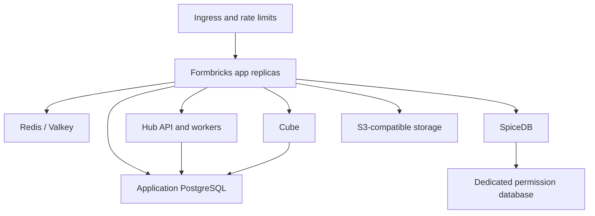

Run app replicas behind your ingress and share the same databases, queues, permission engine and
object storage. Start with [Kubernetes installation](/self-hosting/setup/kubernetes) and the
[component inventory](/self-hosting/operate/components).

Hub can use a separate database. App workers use Redis; Hub workers use PostgreSQL.
SpiceDB is required for permission decisions and has no legacy authorization fallback.

## Availability

- Run multiple app replicas across nodes, with capacity for a failed node and a rolling restart.
- Configure disruption budgets, readiness and your managed datastores for the availability you need.
- Monitor dependency health and permission checks as well as `/health`.

Multiple replicas do not guarantee uninterrupted upgrades. Database, permission-schema and queue
changes may require maintenance. Follow the [Kubernetes upgrade procedure](/self-hosting/upgrade/kubernetes);
use online mode only when the selected release and topology have validated eligibility.

## Scaling

Watch CPU, memory, database connections and [queue depth](/self-hosting/configuration/job-runner)
separately. The default app HPA scales on CPU and memory, not backlog. Limit replicas to available
node and database capacity. Use the [sizing guidance](/self-hosting/overview) as a starting point,
then measure your workload.

All replicas need the same configuration, secrets and asset storage. Configure
[Redis](/self-hosting/configuration/environment-variables) and [file uploads](/self-hosting/configuration/file-uploads)
once for the deployment, not separately per replica.
